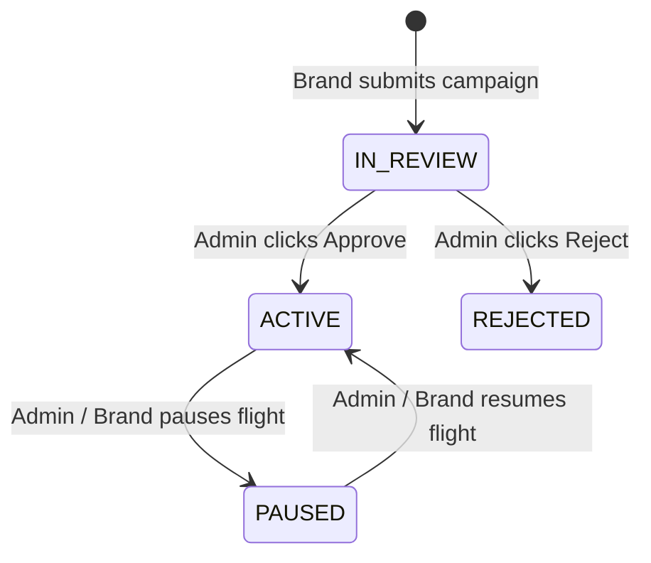

# AdEarn AI — Admin Portal Page Documentation

This document provides a comprehensive operational guide to every page, view, component, action, and access restriction within the AdEarn AI Admin Portal (`/admin/*`).

---

## 1. Operations Overview Dashboard (`/admin`)

- **Route Path**: `/admin`
- **Component**: `src/app/admin/page.tsx`
- **Layout**: `AdminLayout.tsx`
- **Required Role**: `ADMIN` or `SUPER_ADMIN`
- **Required Permission**: `dashboard.read`
- **Primary Data Source**: `GET /api/admin/overview`

### Description & Purpose
The primary command center for platform operations. Provides executive health indicators across the entire multi-tenant ecosystem, displaying real-time counts of verified creators, registered advertiser organizations, active campaigns, pending moderation queues, flagged fraud sessions, and authoritative nodal escrow balances.

### User Actions & Controls
- **Telemetry Cards**: View live counts (`totalUsers`, `totalAdvertisers`, `activeCampaigns`, `pendingModeration`, `pendingPayouts`, `flaggedFraud`).
- **Nodal Reserve Invariant**: Displays total user available obligations vs. advertiser escrow held in 100% regulatory reserve.
- **Recent Audit Stream**: Real-time review of the 10 most recent administrative actions with actor names, timestamps, and action types.
- **Quick Links**: Direct deep-links to Moderation, Fraud Lab, Payout Clearing, and Settings desks.

---

## 2. Campaign Moderation Queue (`/admin/moderation`)

- **Route Path**: `/admin/moderation`
- **Component**: `src/app/admin/moderation/page.tsx`
- **Layout**: `AdminLayout.tsx`
- **Required Role**: `ADMIN` or `SUPER_ADMIN`
- **Required Permission**: `campaigns.moderate`
- **Primary Data Source**: `GET /api/admin/moderation`, `POST /api/admin/moderation`

### Description & Purpose
Provides compliance officers with tools to inspect newly created or updated advertiser campaigns before they are made public to creators. Ensures all target URLs, creative assets, descriptions, and action types comply with platform policies.

### State Transitions

### User Actions & Controls
- **Campaign Inspection**: Review organization name, GSTIN verification badge, campaign title, description, category, target URL, and attached creative assets.
- **Approve Action**: Transitions campaign status to `ACTIVE`. Automatically records a `ModerationRecord` and posts a `MODERATION_DECISION_ACTIVE` audit log entry.
- **Reject Action**: Transitions campaign status to `REJECTED` with required reviewer notes.
- **Pause Action**: Transitions campaign to `PAUSED` if compliance investigations arise mid-flight.

---

## 3. Fraud & Kinematics Forensic Lab (`/admin/fraud-lab` & `/admin/fraud`)

- **Route Path**: `/admin/fraud-lab` (Canonical route) | `/admin/fraud` (Canonical route alias)
- **Component**: `src/app/admin/fraud-lab/page.tsx`
- **Layout**: `AdminLayout.tsx`
- **Required Role**: `ADMIN` or `SUPER_ADMIN`
- **Required Permission**: `fraud.review`
- **Primary Data Source**: `GET /api/admin/fraud`, `POST /api/admin/fraud`

### Description & Purpose
The platform's anti-fraud forensic workbench. Analyzes flagged user task sessions and extension impressions that exceeded heuristic anomaly thresholds or exhibited non-human kinematic patterns (instantaneous clicks, zero dwell time, programmatic scroll macros).

### Forensic Metrics Displayed
- **Bot Intercept Accuracy**: Percentage of automated attacks intercepted (dynamically computed).
- **Average Human Dwell**: Real-time average attention duration calculated across validated submissions.
- **Flagged Sessions Queue**: Active queue of sessions pending human-in-the-loop review.

### User Actions & Controls
- **Quarantine User**: Immediately updates user account status to `SUSPENDED`, preventing further task engagement, reward accrual, or withdrawals. Writes `USER_SUSPENDED_FRAUD_LAB` to the audit log.
- **Clear Session**: Marks the task session verdict as `CLEARED`, resolving the anomaly flag.

---

## 4. Payout Clearing & Nodal Settlement Pool (`/admin/payouts`)

- **Route Path**: `/admin/payouts`
- **Component**: `src/app/admin/payouts/page.tsx`
- **Layout**: `AdminLayout.tsx`
- **Required Role**: `ADMIN` or `SUPER_ADMIN`
- **Required Permission**: `payouts.approve`
- **Primary Data Source**: `GET /api/admin/payouts`, `POST /api/admin/payouts`

### Description & Purpose
The financial clearing desk where compliance officers review, batch-approve, or reject creator withdrawal requests. Enforces strict double-entry ledger settlement against the designated bank nodal pool.

### User Actions & Controls
- **Review Withdrawal Requests**: Inspect user name, email, KYC verification tier, masked destination (UPI / Bank Account), amount in INR, and requested timestamp.
- **Approve Batch**: Dispatches the payout instruction to the banking gateway adapter (`RazorpayXPayoutAdapter` or `SandboxPayoutAdapter`). Upon confirmation, sets status to `CLEARED`, attaches banking UTR number, and emits a balanced journal entry.
- **Reject Request**: Transitions status to `FAILED`, prevents re-clearance, restores the withdrawn funds back to the creator's available wallet balance, and writes a compensating `PAYOUT_REVERSAL` transaction.
- **Terminal State Guard**: Any attempt to clear or reject a payout that is already in `CLEARED`, `FAILED`, or `CANCELLED` is blocked with HTTP 400.

---

## 5. Immutable Audit Logs (`/admin/audit-logs`)

- **Route Path**: `/admin/audit-logs`
- **Component**: `src/app/admin/audit-logs/page.tsx`
- **Layout**: `AdminLayout.tsx`
- **Required Role**: `ADMIN` or `SUPER_ADMIN`
- **Required Permission**: `audit.read`
- **Primary Data Source**: `GET /api/admin/audit-logs`

### Description & Purpose
Provides an immutable, tamper-evident chronological ledger of all administrative interventions, moderation decisions, setting changes, user quarantines, and financial operations.

### Data Attributes Audited
- **Timestamp**: High-precision UTC timestamp.
- **Actor Attribution**: User ID, name, email, and administrative role (`ADMIN` or `SUPER_ADMIN`).
- **Action Type**: Canonical action code (e.g., `MODERATION_DECISION_ACTIVE`, `USER_SUSPENDED_FRAUD_LAB`, `SYSTEM_SETTING_UPDATED`).
- **Entity Identification**: Type (`Campaign`, `User`, `PayoutRequest`, `SystemSetting`) and UUID.
- **State Delta**: Structured JSON representation of modified attributes.
- **Pagination**: Paginated stream with page size selector and action keyword filtering.

---

## 6. Unit Economics & Gross Margins (`/admin/analytics` & `/admin/unit-economics`)

- **Route Path**: `/admin/analytics` (Canonical route) | `/admin/unit-economics` (Canonical route alias)
- **Component**: `src/app/admin/analytics/page.tsx`
- **Layout**: `AdminLayout.tsx`
- **Required Role**: `ADMIN` or `SUPER_ADMIN`
- **Required Permission**: `unit_economics.read`
- **Primary Data Source**: `GET /api/admin/unit-economics`

### Description & Purpose
Telemetry and financial reporting dashboard tracking the macro health and platform take-rate of AdEarn AI. All calculations are performed dynamically from verified database records.

### Dynamic Metrics Calculated
- **Gross Campaign Spend**: $\sum \text{campaign.budgetSpentPaise}$
- **Creator Reward Liabilities**: $\sum \text{userTask.rewardPaise}$ for all validated tasks.
- **Platform Net Contribution Margin**: $\max(0, \text{Gross Spend} - \text{Creator Liabilities})$.
- **Net Take-Rate %**: Ratio of contribution margin to gross campaign spend.
- **Payout Failure Rate**: Percentage of rejected or failed payout requests.
- **Monthly Settlement Trends**: Historical monthly breakdown of gross billable spend vs. creator rewards.

---

## 7. Platform Settings & Access Management (`/admin/settings`)

- **Route Path**: `/admin/settings`
- **Component**: `src/app/admin/settings/page.tsx`
- **Layout**: `AdminLayout.tsx`
- **Required Role**: `ADMIN` (read-only) | `SUPER_ADMIN` (read and update)
- **Required Permission**: `settings.manage` (required for PUT mutations)
- **Primary Data Source**: `GET /api/admin/settings`, `PUT /api/admin/settings`

### Description & Purpose
Tier-0 operational configuration management. Controls global platform rules, withdrawal thresholds, fraud thresholds, and payout adapter operational modes.

### Key Settings Managed
- `minWithdrawalPaise`: Minimum voluntary payout threshold (default: ₹100.00 / 10000 paise).
- `maxDailyEarningCapPaise`: Daily creator earnings cap (default: ₹5,000.00 / 500000 paise).
- `payoutMode`: Active banking mode (`sandbox` or `live`).
- `jwtExpiresIn`: Session token validity window (default: `7d`).
- `autoApproveKycTier1`: Flag governing instant approval of basic KYC.
- `fraudKinematicsThreshold`: Anomaly score sensitivity trigger (default: `0.45`).

