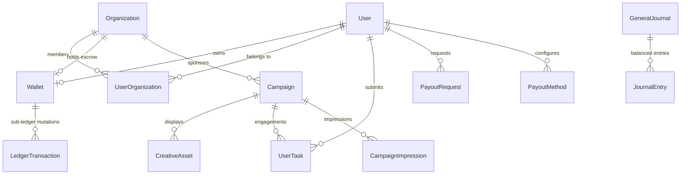

# AdEarn AI — Database Schema Reference Specification

AdEarn AI uses MySQL 8.0 with InnoDB ACID storage engine, managed via Prisma ORM (`prisma/schema.prisma`).

---

## 1. Entity-Relationship Overview

---

## 2. Table Specifications

### 2.1 `User`
Stores creator, advertiser, and administrative accounts.

| Column | Type | Attributes | Description |
|---|---|---|---|
| `id` | `VARCHAR(191)` | PRIMARY KEY, CUID | Unique user identifier |
| `email` | `VARCHAR(191)` | UNIQUE, NOT NULL | Account email address |
| `passwordHash` | `VARCHAR(191)` | NOT NULL | Bcrypt salted hash (factor 10) |
| `name` | `VARCHAR(191)` | NOT NULL | Full name of user |
| `role` | `ENUM` | DEFAULT `'USER'` | `'USER'`, `'ADVERTISER'`, `'ADMIN'` |
| `status` | `ENUM` | DEFAULT `'ACTIVE'` | `'ACTIVE'`, `'SUSPENDED'`, `'PENDING_VERIFICATION'` |
| `kycTier` | `ENUM` | DEFAULT `'TIER_1'` | `'TIER_0'`, `'TIER_1'`, `'TIER_2'` |
| `kycStatus` | `VARCHAR(191)` | DEFAULT `'VERIFIED'` | Verification status string |
| `upiId` | `VARCHAR(191)` | NULLABLE | Default UPI destination address |
| `bankAccountNumber` | `VARCHAR(191)` | NULLABLE | Masked / encrypted bank account |
| `bankIfsc` | `VARCHAR(191)` | NULLABLE | Bank branch IFSC code |

### 2.2 `Wallet`
Maintains user and organization balance projections.

| Column | Type | Attributes | Description |
|---|---|---|---|
| `id` | `VARCHAR(191)` | PRIMARY KEY, CUID | Unique wallet identifier |
| `userId` | `VARCHAR(191)` | UNIQUE, NULLABLE | FK to `User.id` (Creator wallet) |
| `organizationId` | `VARCHAR(191)` | UNIQUE, NULLABLE | FK to `Organization.id` (Brand escrow) |
| `availablePaise` | `BIGINT` | DEFAULT `0` | Immediately withdrawable balance in paise |
| `pendingPaise` | `BIGINT` | DEFAULT `0` | Unsettled or in-review earnings |
| `escrowPaise` | `BIGINT` | DEFAULT `0` | Unreserved advertiser deposit balance |
| `lifetimeEarnedPaise` | `BIGINT` | DEFAULT `0` | Total cumulative verified earnings |
| `lifetimePaidPaise` | `BIGINT` | DEFAULT `0` | Total cumulative settled payouts |

### 2.3 `Campaign`
Stores sponsored attention campaigns.

| Column | Type | Attributes | Description |
|---|---|---|---|
| `id` | `VARCHAR(191)` | PRIMARY KEY, CUID | Unique campaign identifier |
| `organizationId` | `VARCHAR(191)` | NOT NULL | FK to `Organization.id` |
| `title` | `VARCHAR(191)` | NOT NULL | Human-readable title |
| `description` | `TEXT` | NOT NULL | Task briefing & requirements |
| `category` | `VARCHAR(191)` | DEFAULT `'FinTech'` | Campaign industry vertical |
| `actionType` | `ENUM` | DEFAULT `'SURVEY'` | `'SURVEY'`, `'SANDBOX_TRIAL'`, `'APP_INSTALL'`, etc. |
| `pricingModel` | `ENUM` | DEFAULT `'CPO'` | `'CPO'`, `'CPM'`, `'HYBRID'` |
| `status` | `ENUM` | DEFAULT `'DRAFT'` | `'DRAFT'`, `'IN_REVIEW'`, `'ACTIVE'`, `'PAUSED'`, `'COMPLETED'`, `'REJECTED'` |
| `targetUrl` | `TEXT` | NOT NULL | Destination URL |
| `budgetAllocatedPaise` | `BIGINT` | DEFAULT `0` | Locked campaign flight budget |
| `budgetSpentPaise` | `BIGINT` | DEFAULT `0` | Confirmed spent budget in paise |
| `costPerOutcomePaise` | `BIGINT` | DEFAULT `0` | Base CPO fee per validated task |
| `cpmRatePaise` | `BIGINT` | DEFAULT `0` | CPM charge per 1,000 views (advertiser) |
| `creatorImpressionRewardPaise` | `BIGINT` | DEFAULT `0` | CPM reward per 1,000 views (creator) |
| `targetOutcomes` | `INT` | DEFAULT `100` | Target outcomes ceiling |
| `verifiedOutcomes` | `INT` | DEFAULT `0` | Verified conversions completed |
| `impressionsCount` | `INT` | DEFAULT `0` | Total validated impressions recorded |
| `ivtRatePercent` | `FLOAT` | DEFAULT `0.0` | Measured Invalid Traffic (IVT) rate |

### 2.4 `UserTask`
Tracks individual creator engagement sessions.

| Column | Type | Attributes | Description |
|---|---|---|---|
| `id` | `VARCHAR(191)` | PRIMARY KEY, CUID | Unique task session ID |
| `campaignId` | `VARCHAR(191)` | NOT NULL | FK to `Campaign.id` |
| `userId` | `VARCHAR(191)` | NOT NULL | FK to `User.id` |
| `sessionToken` | `VARCHAR(191)` | UNIQUE, NOT NULL | Signed session token |
| `status` | `ENUM` | DEFAULT `'STARTED'` | `'STARTED'`, `'SUBMITTED'`, `'VALIDATED'`, `'REJECTED'` |
| `rewardPaise` | `BIGINT` | DEFAULT `0` | Payable reward in paise |
| `anomalyScore` | `FLOAT` | DEFAULT `0.0` | Kinematic heuristic anomaly score (0.0 to 1.0) |
| `fraudVerdict` | `ENUM` | DEFAULT `'CLEARED'` | `'CLEARED'`, `'FLAGGED'`, `'BLOCKED'` |
| `startedAt` | `DATETIME` | DEFAULT `now()` | Session initialization timestamp |
| `submittedAt` | `DATETIME` | NULLABLE | User submission timestamp |
| `validatedAt` | `DATETIME` | NULLABLE | Verification completion timestamp |

### 2.5 `PayoutRequest`
Voluntary payout requests from creators.

| Column | Type | Attributes | Description |
|---|---|---|---|
| `id` | `VARCHAR(191)` | PRIMARY KEY, CUID | Unique payout identifier |
| `userId` | `VARCHAR(191)` | NOT NULL | FK to `User.id` |
| `amountPaise` | `BIGINT` | NOT NULL | Disbursal amount in paise |
| `method` | `VARCHAR(191)` | DEFAULT `'UPI'` | Disbursal rail (`UPI` or `BANK_ACCOUNT`) |
| `destinationAddress`| `VARCHAR(191)` | NOT NULL | Actual payment address |
| `maskedAddress` | `VARCHAR(191)` | NOT NULL | Masked display representation |
| `status` | `ENUM` | DEFAULT `'REQUESTED'` | `'REQUESTED'`, `'PROCESSING'`, `'CLEARED'`, `'FAILED'`, `'CANCELLED'` |
| `utrNumber` | `VARCHAR(191)` | NULLABLE | Bank Unique Transaction Reference (UTR) |
| `idempotencyKey` | `VARCHAR(191)` | UNIQUE, NOT NULL | Client/System idempotency key |
| `approvedByUserId` | `VARCHAR(191)` | NULLABLE | Admin user who approved clearing |

### 2.6 `AuditLog`
Immutable administrative event log.

| Column | Type | Attributes | Description |
|---|---|---|---|
| `id` | `VARCHAR(191)` | PRIMARY KEY, CUID | Unique audit log ID |
| `actorId` | `VARCHAR(191)` | NOT NULL | FK to `User.id` |
| `actorRole` | `VARCHAR(191)` | NOT NULL | Administrative role string |
| `action` | `VARCHAR(191)` | NOT NULL | Canonical action code |
| `entityType` | `VARCHAR(191)` | NOT NULL | Target entity type (`Campaign`, `User`, etc.) |
| `entityId` | `VARCHAR(191)` | NOT NULL | Target entity UUID |
| `previousState` | `TEXT` | NULLABLE | JSON snapshot before mutation |
| `newState` | `TEXT` | NULLABLE | JSON snapshot after mutation |
| `createdAt` | `DATETIME` | DEFAULT `now()` | Audit record creation timestamp |

