# ADEARNAI — REVISED PHASE EXECUTION PLAN

**Execution Mode:** Sequential Gap Remediation & Full Verification  
**Objective:** Deliver a complete, audited, production-ready hybrid advertising network.  

---

## Phase Execution Sequence

```mermaid
flowchart LR
    P1["Phase 1: Database & Ledger Foundation"] --> P2["Phase 2: Campaign & Creative Engine"]
    P2 --> P3["Phase 3: Central Ad Intelligence Engine"]
    P3 --> P4["Phase 4: Event Settlement & Reconciliation"]
    P4 --> P5["Phase 5: Chrome Extension Compliance"]
    P5 --> P6["Phase 6: Brand Studio Verification"]
    P6 --> P7["Phase 7: Admin Operations Verification"]
    P7 --> P8["Phase 8: Security & QA Performance Audit"]
    P8 --> P9["Phase 9: Production Deployment Preparation"]
```

### Phase 1: Database and Financial Foundation
* **Status:** `COMPLETE & VERIFIED`
* **Artifacts:** `prisma/schema.prisma`, `migration.sql`, `rollback.sql`.
* **Verification:** Disposable database testing passed; live MySQL updated; double-entry ledger reconciled.

### Phase 2: Campaign and Creative Engine
* **Status:** `COMPLETE & VERIFIED`
* **Artifacts:** `src/app/advertiser/campaigns/new/page.tsx`, `src/app/api/advertiser/campaigns/route.ts`.
* **Verification:** CPM, CPC, and CPO models supported; escrow reservation verified.

### Phase 3: Central Ad Intelligence Engine
* **Status:** `IN PROGRESS — FINAL POLISHING`
* **Artifacts:** `src/app/api/ads/serve/route.ts`, `src/lib/ads.ts`.
* **Action:** Enforce daily budget cap and KYC tier filter natively.

### Phase 4: Event Processing and Settlement
* **Status:** `COMPLETE & VERIFIED`
* **Artifacts:** `src/app/api/ads/click/route.ts`, `src/app/api/ads/impression/route.ts`, `src/lib/ads.ts`.
* **Verification:** Rate-limiting, daily frequency caps, SHA-256 deduplication, double-entry settlement pass.

### Phase 5: Chrome Extension (Popup-Only)
* **Status:** `COMPLETE & VERIFIED`
* **Artifacts:** `extension/manifest.json`, `extension/popup.html`, `extension/popup.js`.
* **Verification:** Zero DOM injection, no content scripts, opt-in rewards switch, category preference filters.

### Phase 6: Brand Studio
* **Status:** `COMPLETE & VERIFIED`
* **Artifacts:** `src/app/advertiser/*`, `src/app/advertiser/members/*`.
* **Verification:** Real database metrics, team management, billing & escrow top-up with 18% GST split.

### Phase 7: Admin Operations Desk
* **Status:** `COMPLETE & VERIFIED`
* **Artifacts:** `src/app/admin/*`, `src/app/admin/users/*`, `src/app/admin/placements/*`.
* **Verification:** User management desk, placement inventory desk, moderation queue, forensic fraud lab.

### Phase 8: Complete Security, QA and Performance Audit
* **Status:** `READY FOR EXECUTION`
* **Artifacts:** All 14 automated test suites, TypeScript validation, production build.

### Phase 9: Deployment Preparation
* **Status:** `READY FOR EXECUTION`
* **Artifacts:** `docs/DEPLOYMENT_GUIDE.md`, `docs/DEVOPS_RUNBOOK.md`, `docs/ADEARNAI_FINAL_IMPLEMENTATION_REPORT.md`.
