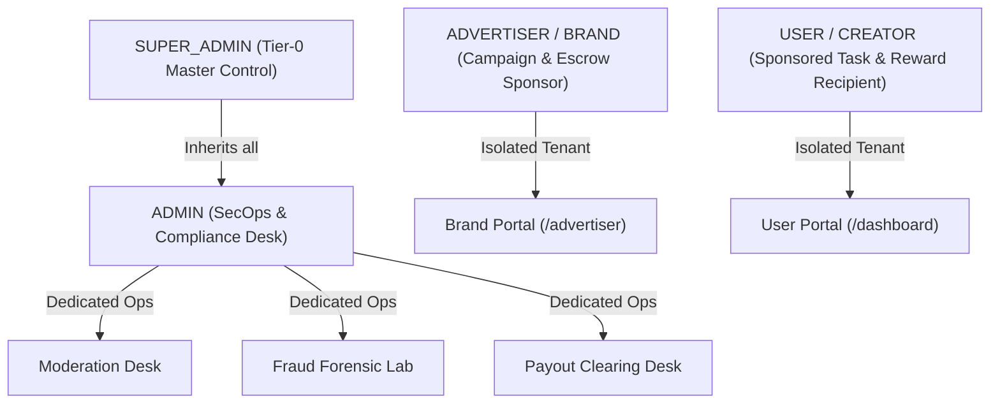

# AdEarn AI — Security Architecture & Role-Based Access Control (RBAC)

## 1. Authentication Architecture

AdEarn AI employs cryptographic JSON Web Token (JWT) session management backed by HMAC-SHA256 signing and bcrypt password hashing.

### Key Authentication Invariants
1. **Password Hashing**: Passwords are saved strictly as bcrypt hashes using salt factor 10. Plaintext passwords never touch disk or logs.
2. **Dual-Mode Session Carrier**: Tokens are accepted via:
   - `Authorization: Bearer <JWT_TOKEN>` header (used by REST clients, extension sessions, and automated testing suites).
   - `adearn_session` HTTP cookie (with `SameSite=Lax`, `Path=/`, and `HttpOnly` in production).
3. **Session Expiry**: Default session duration is 7 days, configurable via `JWT_EXPIRES_IN`.

---

## 2. Institutional Role Hierarchy & Canonical Normalization

The system defines four canonical roles in `src/lib/rbac.ts`:

### Canonical Role Normalization
To preserve backward compatibility while enforcing strict security, `normalizeRole(input)` translates role identifiers:
- `'CREATOR'` -> `'USER'`
- `'BRAND'` -> `'ADVERTISER'`
- `'ADMIN'` -> `'ADMIN'`
- `'SUPER_ADMIN'` -> `'SUPER_ADMIN'`

---

## 3. Granular Administrative Permission Matrix

AdEarn AI implements least-privilege administrative access control. While standard `ADMIN` roles can operate day-to-day moderation and fraud tools, only `SUPER_ADMIN` can alter institutional platform settings.

| Administrative Permission | Action / Scope | Granted to `ADMIN` | Granted to `SUPER_ADMIN` |
|---|---|:---:|:---:|
| `dashboard.read` | View `/admin` overview telemetry and nodal metrics | Yes | Yes |
| `campaigns.moderate` | Approve, reject, or pause advertiser campaigns | Yes | Yes |
| `fraud.review` | Quarantine users and clear flagged telemetry sessions | Yes | Yes |
| `payouts.approve` | Batch-approve or reject creator withdrawals | Yes | Yes |
| `audit.read` | Inspect and filter immutable audit trail logs | Yes | Yes |
| `unit_economics.read` | Access platform gross contribution & take-rate data | Yes | Yes |
| `settings.manage` | Mutate global thresholds, fraud gates, and payout modes | **No (403 Forbidden)** | **Yes (Permitted)** |

---

## 4. Multi-Tenant IDOR Prevention & Organization Isolation

In the Brand Portal, multi-tenancy is strictly isolated at the organization level:
1. Every advertiser campaign is bound to an `organizationId`.
2. Every advertiser user belongs to an organization via `UserOrganization`.
3. When querying campaigns, metrics, or billing invoices, all database queries explicitly filter by `where: { organizationId: auth.session.organizationId }`.
4. Any attempt by Brand A to query or mutate Brand B's campaign ID returns `404 Not Found` or `403 Forbidden`.

---

## 5. Defense-in-Depth Mechanisms

### 5.1 Next.js Edge Middleware
`src/middleware.ts` enforces route boundaries prior to route handler execution:
- `/dashboard/*` requires `USER` or `ADMIN`.
- `/advertiser/*` requires `ADVERTISER` or `ADMIN`.
- `/admin/*` requires `ADMIN` or `SUPER_ADMIN`.
- Unauthenticated requests are immediately redirected to `/login`.

### 5.2 Server-Side Route Guard
Even if middleware is bypassed or misconfigured, every API route in `src/app/api/*` independently invokes `requireRole(...)` or `requireAdminPermission(...)`, guaranteeing that unauthorized calls receive HTTP 401 or 403.

### 5.3 BigInt Serialization Protection
JavaScript native `JSON.stringify` throws a `TypeError: Do not know how to serialize a BigInt` when processing Prisma models with integer paise fields. All API responses pass through `serializeBigInts(...)` from `@/lib/money`, safely converting BigInts to string representations without precision loss.