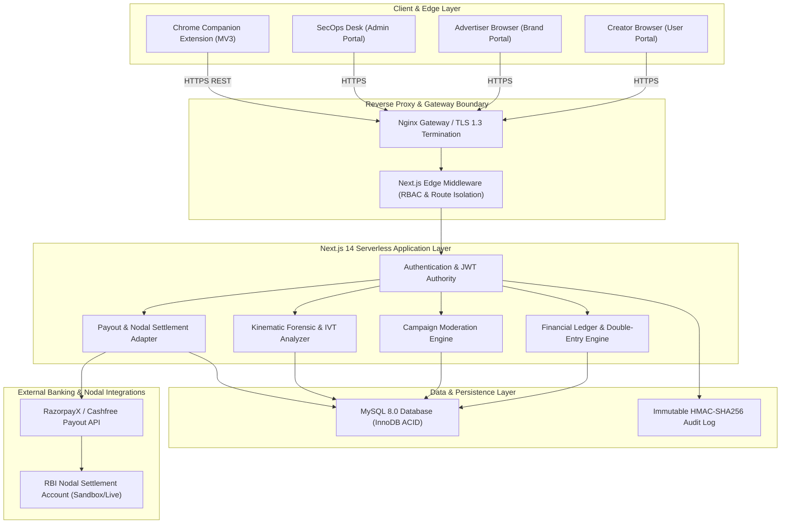

# AdEarn AI — System Architecture & Technical Design

## 1. Executive Architecture Summary

AdEarn AI is an institutional-grade, three-portal platform engineered for voluntary sponsored-attention monetization, digital campaign attribution, and cryptographic proof-of-human attention. The application is built upon Next.js 14 (App Router), TypeScript, and a high-concurrency MySQL 8.0 relational database with strict double-entry ledger accounting.

The platform provides three strictly separated operating portals:
1. **User / Creator Portal (`/dashboard`, `/tasks/*`, `/wallet`, `/withdrawals`, `/profile`)**: Allows verified individuals to discover sponsored campaigns, engage in validated tasks, earn integer-paise rewards, and request voluntary withdrawals.
2. **Brand / Advertiser Portal (`/advertiser/*`)**: Enables enterprise brands and advertisers to fund nodal escrow pools, launch CPO/CPM attention campaigns, track kinematic telemetry, and review real-time attribution analytics.
3. **Admin / Forensic Operations Portal (`/admin/*`)**: Provides tier-0 platform administrators, compliance officers, and fraud researchers with campaign moderation desks, kinematic forensic labs, batch payout clearing controls, immutable audit logs, and institutional unit economics telemetry.

---

## 2. Core Architectural Pillars

### 2.1 Complete Portal Separation & Server-Enforced RBAC
- **Canonical Roles**: `USER`, `ADVERTISER`, `ADMIN`, `SUPER_ADMIN`.
- **No Shared Session Leakage**: A creator session cannot access `/advertiser/*` or `/admin/*`. An advertiser session cannot access `/dashboard/*` or `/admin/*`. Unprivileged administrators cannot execute tier-0 operations reserved for `SUPER_ADMIN` (e.g., system settings mutation).
- **Dual-Layer Enforcement**: Edge Next.js `middleware.ts` intercepts all route requests before rendering; every internal API route independently validates session authentication and required granular permission flags (`campaigns.moderate`, `payouts.approve`, `fraud.review`, `settings.manage`, `audit.read`).

### 2.2 Double-Entry Accounting & Exact Integer Money Math
- **Integer Paise Representation**: All financial values (`availablePaise`, `escrowPaise`, `amountPaise`, `chargePaise`, `rewardPaise`) are stored as 64-bit BigInt integers. Floating-point arithmetic is strictly prohibited in monetary paths.
- **Double-Entry Equilibrium**: Every economic transaction posts balanced journal entries across institutional chart of accounts:
  - `1010_NODAL_BANK_ASSET` (Asset)
  - `2010_ADVERTISER_ESCROW_LIABILITY` (Liability)
  - `2020_CAMPAIGN_RESERVE_LIABILITY` (Liability)
  - `2030_CREATOR_PAYABLE_LIABILITY` (Liability)
  - `2040_CREATOR_PENDING_LIABILITY` (Liability)
  - `4010_PLATFORM_FEE_REVENUE` (Revenue)
- **Zero-Loss CPM Margins**: Impression charges and creator rewards are computed via marginal delta aggregation (`calculateMarginalCpmPaise`), guaranteeing mathematical precision without fractional paise leakage over millions of impressions.

### 2.3 Kinematic Attention Forensics
- **Client Telemetry**: User engagement with sponsored activities captures attention dwell time, micro-cursor trajectory coordinates, velocity vectors, and scroll acceleration.
- **Bot Interception**: Instantaneous click bots, synthetic mouse generators, and headless automated macros are rejected at the edge with HTTP 422/400 and logged to the Forensic Lab with anomaly scores.

### 2.4 Payout Lifecycle & Terminal State Protection
- **State Machine**: `REQUESTED` -> `PROCESSING` -> `CLEARED` (terminal) or `FAILED`/`CANCELLED` (terminal).
- **Single-Reversal Guarantee**: Once a payout reaches a terminal state, subsequent approval or rejection attempts are strictly blocked with HTTP 400. Rejection restores funds atomically to the creator's wallet with an immutable audit log.

